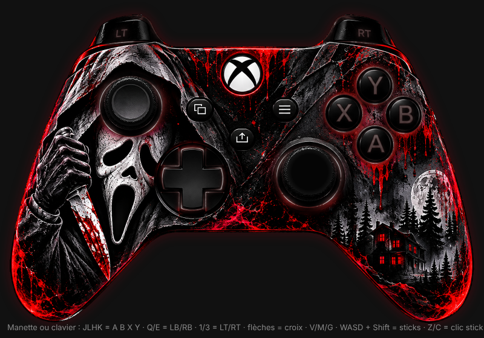
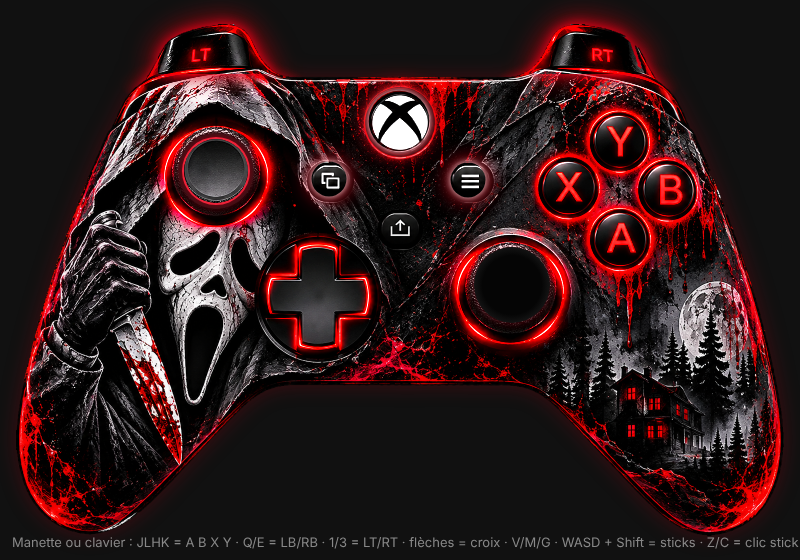

# Overlay manette Xbox – Scream / Ghostface

Thème Xbox pour [Gamepad Viewer](https://gamepadviewer.com), adapté de
`scream_ghostface_gpv_safe.css` ([ScReaMCOD/Overlay-manette-ps5](https://github.com/ScReaMCOD/Overlay-manette-ps5)).

La manette entière est dessinée avec `ghostface_raiju_shell.png` :

- **au repos**, les lumières rouges autour des boutons (A B X Y, croix, anneaux des sticks, LT/RT) sont éteintes : désaturées et assombries ;
- **à l'appui**, la zone retrouve le rouge du PNG, avec un halo rouge sang ;
- LT/RT s'allument progressivement selon la pression ;
- LB/RB : le bord rouge de l'épaule s'embrase ;
- les sticks bougent avec la tête de stick découpée dans l'image, et L3/R3 allument l'anneau ;
- le logo Xbox reste allumé, comme le voyant d'une vraie manette.

## Utilisation

Lien direct (navigateur ou source navigateur OBS **800 × 560**) :

https://gamepadviewer.com/?p=1&css=https%3A%2F%2Fcdn.jsdelivr.net%2Fgh%2FLeBadMood%2Foverlay-manette%40main%2Fscream_ghostface_xbox.css

Appuie sur un bouton de la manette pour qu'elle soit détectée.
Si une autre manette s'affiche, choisis **Xbox One** dans Gamepad Viewer.

L'image est chargée depuis
`https://raw.githubusercontent.com/LeBadMood/overlay-manette/main/ghostface_raiju_shell.png`.
Pour l'héberger ailleurs, change `--shell` en haut du CSS.
Pour régler l'intensité des lumières éteintes, change `--off`.

## Aperçu local

Ouvre `preview.html` dans un navigateur (manette branchée ou clavier :
J L H K = A B X Y, Q/E = LB/RB, 1/3 = LT/RT, flèches = croix, V/M = View/Menu,
WASD = stick gauche, Shift + WASD = stick droit, Z/C = clic des sticks).
